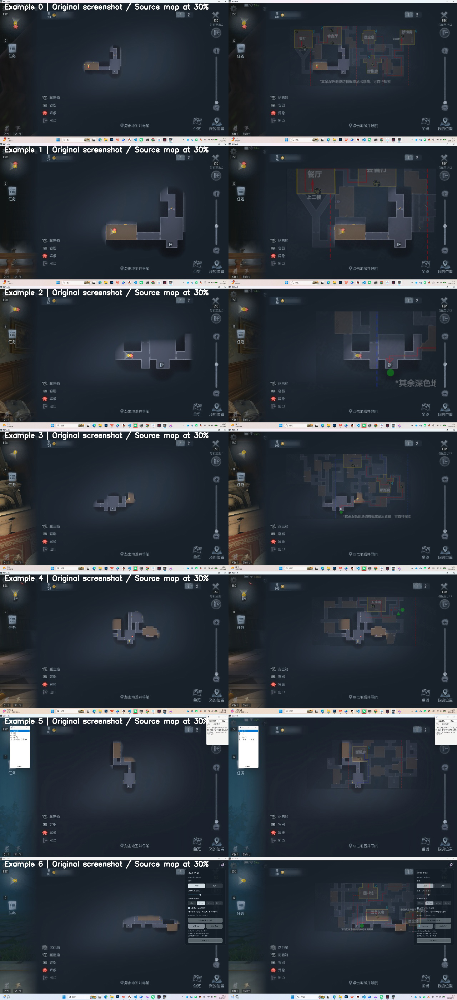
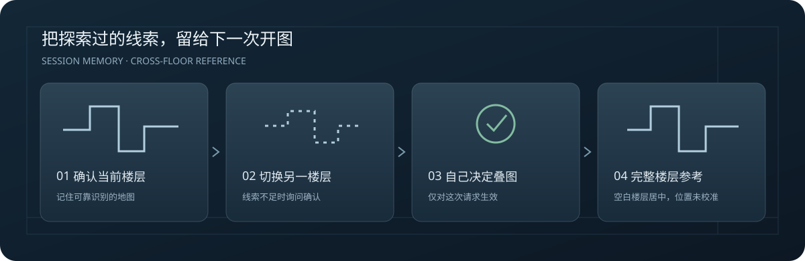

# 加页手记 · 地图助手

一只陪你找路的小布偶，也带来一点等待时的乐趣。

<a href="https://gitcode.com/weixin_51917701/crypticNotes/releases">国内下载</a> · <a href="https://github.com/HenryChen27/crypticNotes/releases/latest">GitHub 下载</a> · <a href="android/README.md">安卓说明</a> · <a href="docs/releasing.md">构建与发布</a>

为《第五人格》「加页手记」模式制作的悬浮地图助手，支持 Windows、macOS 和 Android。打开游戏地图后，助手根据可见地形匹配地图库，将该楼层的完整地图和参考路线半透明叠在游戏画面上。

程序读取画面进行识别，不读取游戏内存、不修改游戏文件、不注入游戏进程。局部地形可能相似，叠图请结合房间、路口核对。

## 下载

在 [GitCode 国内下载](https://gitcode.com/weixin_51917701/crypticNotes/releases) 或 [GitHub Releases](https://github.com/HenryChen27/crypticNotes/releases/latest) 选择对应附件：

| 平台 | 安装包 |
| --- | --- |
| Windows 64 位 | `IdentityVMapAssistant-Windows-x64.zip` |
| Mac Apple 芯片 | `IdentityVMapAssistant-macOS-arm64.zip` |
| Mac Intel 芯片 | `IdentityVMapAssistant-macOS-x64.zip` |
| Android ARM64 | `IdentityVMapAssistant-Android-arm64.apk` |

开发中的功能可能尚未进入公开安装包，请以对应版本的更新公告为准。

## 开始使用

电脑和手机都可以在「通用设置 → 邮箱」点开一封邮件，用大字阅读完整内容。邮箱按发送时间保留最新 20 封；超出时自动删除最早的邮件，未读和必读邮件也不例外。只看列表不会消除未读标记；「一键已读」会跳过必读邮件。正式更新公告随安装包提供，首次打开新版本时会自动显示，不需要联网，也不占邮箱名额。

### Windows

1. 完整解压，启动 `crypticNotes.cmd`。保留旁边的地图库和资源文件。
2. 点击布偶，选择正在玩的篇章和难度。使用凉哈皮的厄运之女噩梦地图时，再选择单人或多人路线。
3. 将插件的地图快捷键设置成游戏中的开图键，默认 `G`。关闭地图快捷键默认 `Esc`，可分别修改。
4. 返回游戏打开地图，等待识别。拖动、缩放游戏地图后，助手会尝试重新对齐。

游戏以管理员权限运行时，插件也需要相应权限才能稳定接收后台快捷键，启动时留意系统授权提示。快捷键支持键盘和鼠标按钮。`create-shortcut.cmd` 可以生成快捷方式。

### macOS

将应用放入“应用程序”，允许屏幕录制和输入监控，再完全退出、重新打开。使用与游戏一致的地图快捷键。

系统的“无法验证开发者”提示与采集授权是两件事。只对你确认来源的安装包，使用“系统设置 → 隐私与安全性”中提供的打开选项。截图或热键异常时，可运行包内的 `诊断问题.command`。

### Android

安装 APK，在「加页手记」下载主程序，再选择难度、允许悬浮窗和屏幕采集。返回游戏横屏打开地图，悬浮球显示当前状态。

没有开始识别时，双击悬浮球，或打开设置点击“重新识别”。分享单个应用和整个屏幕的可用性由 Android 版本及设备决定。系统录屏可能与插件采集冲突，可使用插件内置录屏。

## 地图识别与强行叠图

桌面和 Android 的「小布偶」（原名「原创」）随加页手记主程序一起下载，并默认启用。厄运之女四个难度共 94 个布局，磷光症三个难度共 55 个布局。在「加页手记 → 地图设置」点电脑的「管理地图」或手机的「地图库」可预览楼层。手机上的三套地图均只读；电脑上可在管理窗口录入或删除凉哈皮、展十的地图。想恢复作者路线，先到「加页手记 → 版本」下载对应地图库，再到「地图设置 → 地图版本」切换。

三个栏目分别下载主程序，装好后在各栏的「版本」管理包。删除主程序会一并移除本栏可选包，保留个人地图、设置和存档。桌面各栏有独立的「快捷键」。右键桌宠（手机打开「通用设置」）可一键更新已经下载的包。Android 的录屏在「通用设置 → 录屏设置」，小游戏高刷新率在「小游戏 → 小游戏设置」，原 PVP 入口改名「禁选辅助」。

小布偶先读当前楼层，再用已探索的房间、走廊和侧门认布局。例如噩梦二楼的 `104001` 和 `104005` 局部地形相同，侧门位置不同。首次匹配如果并列，会试叠并提示核对；如果连可定位的地形都没有，就等画面有线索后再认。成功显示后记住布局和楼层。第一次切到新楼层，即使还没探索，也显示记忆图对应的那一层。没有足够路口校准时沿用上次视图，显示「位置待校准」。已叠过的一层如果重新对不上，不硬贴；证据能确认另一布局时，换图并从当前层重新记。切换篇章、难度、图库或重启识别服务会清空会话记忆。

如果记住的是只有一楼的图，后来却读到了二楼，这条线索就能排除旧图。只在有二楼的布局里重新匹配：能定位就先叠，并列时提示核对；不会把旧图的一楼当成二楼。

匹配后，助手把楼层显示图缩放、平移到游戏画面上，不会每帧重画。小布偶、凉哈皮和展十的地图库预览和叠图都使用同一套轻微加噪显示：从原稿解码时，在约 1/16 的合适像素上把颜色调亮或调暗 1 级。重复打开同一张图，噪点位置不变；透明度、展十的黑底遮罩、原稿、玩家截图和识别特征不变。旧作者包和新录入的地图也走这条显示路径，不需要重建索引。维护者运行 `python scripts/preview_map_grain.py` 可在 `out/map-grain/index.html` 查看同一局部的原图、显示图和放大色差；加 `--export-all` 可另存完整图库的无损 PNG。

维护者可用 `python scripts/build_layout_library.py all` 根据 `story/地图索引.md`、索引原图和本地配置重建七个难度的图库。运行时不需要 `story/`。[三种图库的同帧对照与局限](datasets/evaluation/20261120-layout-match/indexed-providers.md)。

维护者可运行 `python scripts/preview_layout_components.py --schematic`，在 `out/map-preview/schematic-2f.png` 对照这两个二楼的线稿。它按格子、门和路线画图，不把游戏贴图贴进画面；它只生成本地样图，不替换安装包。当前内置库中，`art.npz` 的显示图仍来自索引图，`layouts.npz` 的地形轮廓由游戏素材提取，`side-exits.json` 还含游戏出口图标的灰度识别模板。

以下手动确认流程适用于凉哈皮和展十，小布偶使用上面的自动规则。

- 已可靠识别的地图保留在本次会话中，后续打开优先对齐，减少重复搜索。
- 地图很快关闭时，已提交的任务可在后台完成并记住结果，不会重新弹出叠图。
- 确认一个楼层后，切换另一层遇到证据不足或候选接近，可询问是否直接叠图。绿勾同意，也可按确认叠图快捷键（默认回车，在「加页手记 → 快捷键」里修改或关闭）；红叉或 Esc 忽略，倒计时结束自动关闭。
- 强行叠图只对这次请求生效。有地形时尝试对齐；空白或无法可靠对齐时居中显示，位置未校准，不能当作实际坐标。
- 显示完整楼层，超出屏幕的部分自然位于屏幕外。识别时限制过小的缩放比例。

Windows 窗口采集直接读取游戏画面，避免布偶遮挡识别区域；Mac 使用自己的窗口采集实现，Android 使用系统屏幕共享接口。三端共用匹配核心和官方地图库，但采集方式与屏幕比例仍会影响输入画面。

## 布偶和设置

点击布偶打开设置，双击重新识别，拖动改变位置。识别时布偶显示循环动作，齿轮外观显示旋转反馈。透明度、字体、外观与快捷键可在设置中调整。

桌面端拖入右上角删除区域并停留约半秒可退出，下次保留拖入前的位置。桌面托盘／Mac 菜单栏也有退出入口；安卓通过悬浮设置或通知栏停止。

## 等待时玩一局合成大水母

小游戏是可选下载，地图助手本体不附带完整游戏资源。在小游戏一栏下载、启动或删除，独立窗口保留游戏原本的画面与玩法，资源与存档分开管理。

小游戏运行期间暂停地图识别。手机最小化后，悬浮球换成蓝水母：单击打开设置，双击恢复小游戏，也可以从通知栏恢复。桌面使用布偶旁的后台指示和恢复入口。

Windows 本机实验可检测大厅画面的大幅变化，先收起小游戏，再等待 5 秒；期间恢复则继续，否则安全保存后关闭。这项实验并非所有公开版本、所有平台均已提供。

游戏项目：[HenryChen27/Jellyfish](https://github.com/HenryChen27/Jellyfish)。

## 手机录屏

画质、声音、是否录入插件界面及微震动在应用内设置。悬浮界面负责开始／结束录制；开始后收起设置，录制状态以图案呼吸变化提示。

录制中长按悬浮球先结束录屏，再次长按停止共享。仅分享单个应用时，录入插件界面依赖录制合成选项。声音采集受系统版本和被录应用限制。

## 更新、地图库和反馈

新版客户端的主程序与地图库更新优先使用 GitCode，更新查询连接失败时回退 GitHub；文件大小和 SHA-256 校验保持启用。Windows、Android 使用各自的更新流程；Mac 下载对应芯片安装包后替换应用。已安装的旧版需先更新一次才能启用新通道。小游戏资源暂时仍使用原仓库。更新失败时查看日志。

凉哈皮和展十支持录入和删除，小布偶只读。桌面支持多楼层框选；Android 录入单层图片时选择对应楼层。更新作者包时会保留个人地图；删除单张地图则无法撤销。早期整目录替换版本首次迁移前请备份图库并阅读 [地图库更新说明](docs/map-library-updates.md)。

开启“记录识别案例”后，成功与失败截图及诊断信息保存在本地，不自动上传。反馈请提供平台、版本、难度、路线模式和完整记录目录，发送前检查截图中的个人信息。

- [案例与日志](docs/failure-records.md)
- [安卓详细说明](android/README.md)
- [小游戏集成](docs/minigames.md)
- [自己构建与发布](docs/releasing.md)

作者：[被诅咒的无名布偶](https://space.bilibili.com/3747565201787057/)。个人维护的辅助工具，非游戏官方产品。
