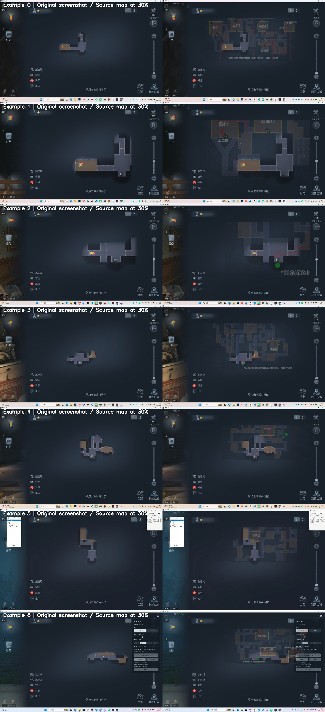
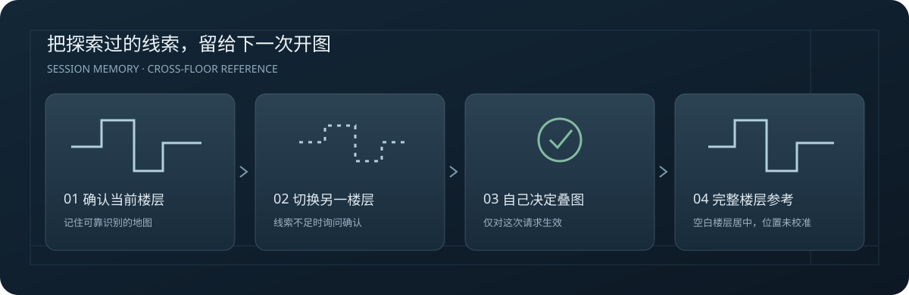

# 加页手记 · 地图助手

一只陪你找路的小布偶，也带来一点等待时的乐趣。

<a href="https://github.com/HenryChen27/crypticNotes/releases/latest">下载最新版</a> · <a href="android/README.md">安卓说明</a> · <a href="docs/releasing.md">构建与发布</a>

为《第五人格》「加页手记」模式制作的悬浮地图助手，支持 Windows、macOS 和 Android。打开游戏地图后，助手根据可见地形匹配地图库，将该楼层的完整地图和参考路线半透明叠在游戏画面上。

程序读取画面进行识别，不读取游戏内存、不修改游戏文件、不注入游戏进程。局部地形可能相似，叠图请结合房间、路口核对。

## 下载

在 [GitHub Releases](https://github.com/HenryChen27/crypticNotes/releases/latest) 选择对应附件：

| 平台 | 安装包 |
| --- | --- |
| Windows 64 位 | `IdentityVMapAssistant-Windows-x64.zip` |
| Mac Apple 芯片 | `IdentityVMapAssistant-macOS-arm64.zip` |
| Mac Intel 芯片 | `IdentityVMapAssistant-macOS-x64.zip` |
| Android ARM64 | `IdentityVMapAssistant-Android-arm64.apk` |

开发中的功能可能尚未进入公开安装包，请以对应版本的更新公告为准。

## 开始使用

### Windows

1. 完整解压，启动 `crypticNotes.cmd`。保留旁边的地图库和资源文件。
2. 点击布偶，选择困难或噩梦；噩梦再选择单人或多人路线。
3. 将插件的地图快捷键设置成游戏中的开图键，默认 `G`。关闭地图快捷键默认 `Esc`，可分别修改。
4. 返回游戏打开地图，等待识别。拖动、缩放游戏地图后，助手会尝试重新对齐。

游戏以管理员权限运行时，插件也需要相应权限才能稳定接收后台快捷键，启动时留意系统授权提示。快捷键支持键盘和鼠标按钮。`create-shortcut.cmd` 可以生成快捷方式。

### macOS

将应用放入“应用程序”，允许屏幕录制和输入监控，再完全退出、重新打开。使用与游戏一致的地图快捷键。

系统的“无法验证开发者”提示与采集授权是两件事。只对你确认来源的安装包，使用“系统设置 → 隐私与安全性”中提供的打开选项。截图或热键异常时，可运行包内的 `诊断问题.command`。

### Android

安装 APK，选择难度与路线模式，允许悬浮窗和屏幕采集，开始识图后返回游戏。横屏打开地图，悬浮球显示当前状态。

没有开始识别时，双击悬浮球，或打开设置点击“重新识别”。分享单个应用和整个屏幕的可用性由 Android 版本及设备决定。系统录屏可能与插件采集冲突，可使用插件内置录屏。

## 地图识别与强行叠图

- 已可靠识别的地图保留在本次会话中，后续打开优先对齐，减少重复搜索。
- 地图很快关闭时，已提交的任务可在后台完成并记住结果，不会重新弹出叠图。
- 确认一个楼层后，切换另一层遇到证据不足或候选接近，可询问是否直接叠图。绿勾同意、红叉忽略；倒计时结束自动关闭。
- 强行叠图只对这次请求生效。有地形时尝试对齐；空白或无法可靠对齐时居中显示，位置未校准，不能当作实际坐标。
- 显示完整楼层，超出屏幕的部分自然位于屏幕外。识别时限制过小的缩放比例。

Windows 窗口采集直接读取游戏画面，避免布偶遮挡识别区域；Mac 使用自己的窗口采集实现，Android 使用系统屏幕共享接口。三端共用匹配核心和官方地图库，但采集方式与屏幕比例仍会影响输入画面。

## 布偶和设置

点击布偶打开设置，双击重新识别，拖动改变位置。识别时布偶显示循环动作，齿轮外观显示旋转反馈。透明度、字体、外观与快捷键可在设置中调整。

桌面端拖入右上角删除区域并停留约半秒可退出，下次保留拖入前的位置。桌面托盘／Mac 菜单栏也有退出入口；安卓通过悬浮设置或通知栏停止。

## 等待时玩一局合成大水母

小游戏是可选下载，地图助手本体不附带完整游戏资源。在小游戏一栏下载、启动或删除，独立窗口保留游戏原本的画面与玩法，资源与存档分开管理。

小游戏运行期间暂停地图识别。手机最小化后，悬浮球换成蓝水母：单击打开设置，双击恢复小游戏，也可以从通知栏恢复。桌面使用布偶旁的后台指示和恢复入口。

Windows 本机实验可检测大厅画面的大幅变化，先收起小游戏，再等待 5 秒；期间恢复则继续，否则安全保存后关闭。这项实验并非所有公开版本、所有平台均已提供。

游戏项目：[HenryChen27/Jellyfish](https://github.com/HenryChen27/Jellyfish)。

## 手机录屏

画质、声音、是否录入插件界面及微震动在应用内设置。悬浮界面负责开始／结束录制；开始后收起设置，录制状态以图案呼吸变化提示。

录制中长按悬浮球先结束录屏，再次长按停止共享。仅分享单个应用时，录入插件界面依赖录制合成选项。声音采集受系统版本和被录应用限制。

## 更新、地图库和反馈

启动时检查更新，有新版时提示。Windows、Android 使用各自的更新流程；Mac 下载对应芯片安装包后替换应用。更新失败时查看日志。

Windows／Android 更新官方地图时保留用户自建地图。早期整目录替换版本首次迁移前，请备份图库并阅读 [地图库更新说明](docs/map-library-updates.md)。Android 当前不提供桌面版完整录入界面；Mac 手动替换应用包需自行备份自建地图。

开启“记录识别案例”后，成功与失败截图及诊断信息保存在本地，不自动上传。反馈请提供平台、版本、难度、路线模式和完整记录目录，发送前检查截图中的个人信息。

- [案例与日志](docs/failure-records.md)
- [安卓详细说明](android/README.md)
- [小游戏集成](docs/minigames.md)
- [自己构建与发布](docs/releasing.md)

作者：[被诅咒的无名布偶](https://space.bilibili.com/3747565201787057/)。个人维护的辅助工具，非游戏官方产品。
